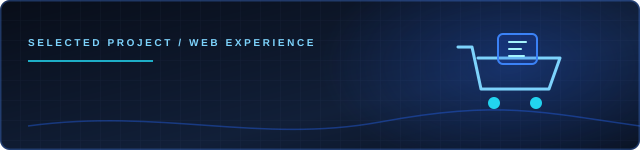
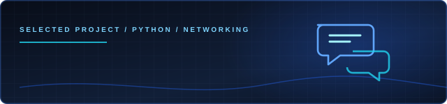
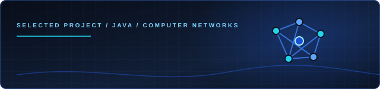
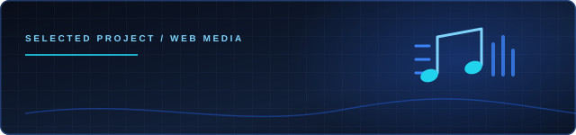

  

  <h1>Md. Hasibul Islam Anik</h1>
  <h3>Computer Science Student · Software Developer · Curious Builder</h3>
  
Building practical software, understanding systems, and exploring what comes next.

  
  
  

---

## 👋 About Me

I'm **Md. Hasibul Islam Anik**, a Computer Science and Engineering student at **Green University of Bangladesh**. I enjoy turning concepts into working software—from interactive web interfaces to Python desktop applications and networking simulations.

I value clear problem-solving, readable code, and understanding how systems work beneath the surface. I'm strengthening my software development fundamentals while exploring **AI/LLM applications and Web3 development**.

- 🧩 **Software development:** Breaking problems into practical, maintainable solutions.
- 🐍 **Python & networking:** Desktop interfaces, TCP sockets, and client–server communication.
- 🌐 **Web development:** Interactive interfaces using HTML, CSS, and JavaScript.
- ⛓️ **Web3:** Exploring Ethereum, Solidity, smart contracts, and Ethers.js.
- 🤖 **AI:** Learning how LLM-powered tools and applications are designed.

---

<table>
  <tr>
    <td width="50%" valign="top">
      <h3>01 / Languages & Web</h3>
      

        
        
        
        
        
      

    </td>
    <td width="50%" valign="top">
      <h3>02 / Frameworks & Libraries</h3>
      

        
        
        
        
      

    </td>
  </tr>
  <tr>
    <td width="50%" valign="top">
      <h3>03 / Systems & Developer Tools</h3>
      

        
        
        
        
      

    </td>
    <td width="50%" valign="top">
      <h3>04 / Currently Exploring</h3>
      

        
        
        
        
      

    </td>
  </tr>
</table>

---

<table>
  <tr>
    <td width="50%" valign="top">
      
      <h3><a href="https://github.com/Anik2059/MJ_SHOPPING">MJ Shopping</a></h3>
      
A shopping interface for browsing products, filtering items, managing a cart, and exploring a checkout flow.

      
  

      <a href="https://github.com/Anik2059/MJ_SHOPPING">View repository →</a>
    </td>
    <td width="50%" valign="top">
      
      <h3><a href="https://github.com/Anik2059/Clients-and-Server-Chat-Application">Python Client–Server Chat</a></h3>
      
A desktop chat project demonstrating GUI design, TCP socket communication, and client–server architecture.

      
  

      <a href="https://github.com/Anik2059/Clients-and-Server-Chat-Application">View repository →</a>
    </td>
  </tr>
  <tr>
    <td width="50%" valign="top">
      
      <h3><a href="https://github.com/Anik2059/Tcp-flow-congestion-java">TCP Flow & Congestion Simulator</a></h3>
      
A Java simulation project for exploring TCP flow control and congestion-control behavior.

      
 

      <a href="https://github.com/Anik2059/Tcp-flow-congestion-java">View repository →</a>
    </td>
    <td width="50%" valign="top">
      
      <h3><a href="https://github.com/Anik2059/MJ-Music-PLAYER">MJ Music Player</a></h3>
      
A browser-based music project bringing audio, video, and playlist-style content together in one interface.

      
  

      <a href="https://github.com/Anik2059/MJ-Music-PLAYER">View repository →</a>
    </td>
  </tr>
</table>

---

  
  
    
  

Stats are generated by third-party widgets and may occasionally be unavailable or delayed.

---

<table>
  <tr>
    <td width="50%" valign="top">
      <h3>01 · Engineering Foundations</h3>
      Build stronger fundamentals in data structures, problem-solving, clean code, and software design.
    </td>
    <td width="50%" valign="top">
      <h3>02 · Python & Full-Stack Development</h3>
      Develop useful applications and improve skills across Python, JavaScript, web interfaces, and APIs.
    </td>
  </tr>
  <tr>
    <td width="50%" valign="top">
      <h3>03 · Systems & Networking</h3>
      Deepen understanding of TCP/IP, client–server communication, and reliable software systems.
    </td>
    <td width="50%" valign="top">
      <h3>04 · AI & Web3</h3>
      Explore LLM-powered applications, Ethereum, Solidity, smart contracts, and Ethers.js through practical learning.
    </td>
  </tr>
</table>

---

  
Have feedback, a project idea, or an opportunity to collaborate? I'd be glad to connect.

  
  
    
  <strong>Learn continuously. Build thoughtfully. Share what works.</strong>

---

  Thanks for stopping by — the best projects start with curiosity.

